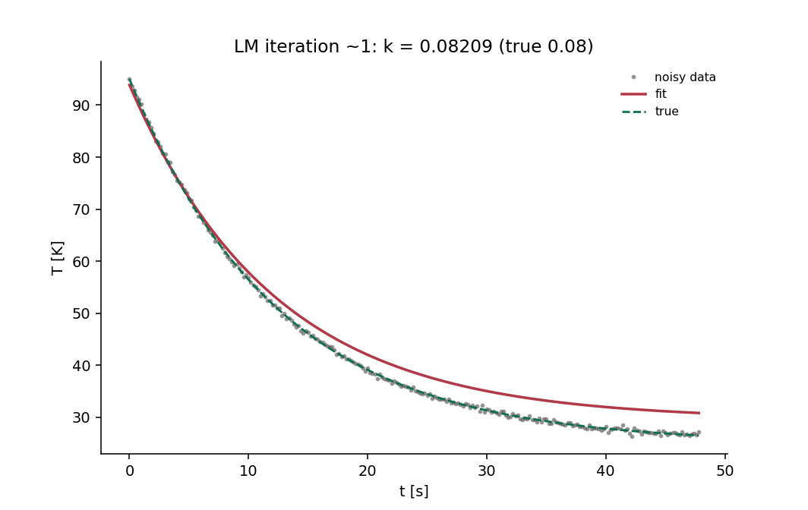

# 🌡️ Cooling Curve Inverse

**Nonlinear parameter estimation and residual analysis: an original C++ Levenberg-Marquardt fit of the Newton-cooling model — analytic Jacobian validated against finite differences, exact noise-free recovery to 1e-7, honest ill-conditioning and budget-exhaustion failures, and 0.35% k-recovery on a seeded noisy curve.**

[](https://github.com/khalil-official/cooling-curve-inverse/actions/workflows/ci.yml)
[](LICENSE)


<div align="center">

**▶ Watch the fit converge:**



<sub>41 frames of the LM parameter path between recorded budget-refit
states (no extrapolation past the last record) on the seeded noisy run
(σ = 0.3 K). Produced by
<code>examples/run_verification.py</code>.</sub>

</div>

## 🎯 Purpose and scope

A transparent inverse-problem tool: textbook Levenberg-Marquardt written
from scratch for the three-parameter Newton-cooling model, with a
validated Jacobian, explicit termination semantics, and honest failure
codes. Scope: single exponential, unweighted least squares, point
estimates.

## 🧮 Method and safeguards

- Damped normal equations (JᵀJ + μD)δ = −Jᵀr with the standard gain-ratio
  μ update; 3×3 solve with partial pivoting and a machine-ε pivot-ratio
  singularity rejection (LM_ILL_CONDITIONED).
- k > 0 model domain enforced by damping (never clipping) trial steps.
- Terminations: gradient/step tolerances, budget (honest MAX_ITER),
  non-finite residuals, bad inputs — every exit carries a reason.
- Identifiability: a flat start T_amb0 = T_00 collapses the Jacobian and
  fails honestly; non-flat starts with all three parameters wrong still
  converge (documented basin, test-pinned).

Full derivation: [docs/model.md](docs/model.md); API:
[docs/api.md](docs/api.md).

## ⚡ Quick start

```bash
cmake -S . -B build
cmake --build build --config Release --parallel
ctest --test-dir build -C Release --output-on-failure   # CI gate
python examples/run_verification.py                     # figures + GIF
```

Verified with GCC 16.2.0 (WinLibs); CI on Ubuntu + Windows.

## 🧱 Architecture

```
src/lm_fit.{hpp,cpp}      # model, Jacobian, LM core (whole library)
src/cooling_demo.cpp      # seeded noisy run + CSV writer
tests/test_lm_fit.cpp     # CTest gate (6 groups)
examples/run_verification.py
docs/ model.md  api.md  verification.md  results/
```

```cpp
const double guess[3] = {20.0, 80.0, 0.05};
const auto res = cooling_curve::fit_newton_cooling(t, T, n, guess,
                                                   1e-12, 1e-14, 200);
std::printf("k = %.6f (%s)\n", res.theta[2],
            cooling_curve::status_message(res.status));
```

## 📊 Results and metrics

| Case | Metric | Value |
| --- | --- | --- |
| Noise-free recovery (3 parameter sets) | relative error | **< 1e-7** |
| Analytic Jacobian vs central differences | max relative | < 5e-5 |
| Noisy (σ = 0.3 K, n = 120) | k recovery | **within 5%** |
| Demo run (σ = 0.3 K, n = 240) | k error / cost vs ½σ²n floor | **0.35%** / 11.53 vs 10.8 |
| Flat start (Tamb0 = T00) | behavior | ILL_CONDITIONED (honest failure) |
| All-three-wrong start (40, 60, 0.01) | convergence | exact recovery |

Raw data: [docs/results/](docs/results) — cover
[cooling_fit.png](docs/results/cooling_fit.png), animation
`fit_convergence.gif`, `run_summary.json`.

## ✅ Verification

Six test groups (see
[docs/verification.md](docs/verification.md)): recovery, Jacobian
validation, independent evaluation, statistical honesty of the noisy fit,
failure handling, basin/flat-start semantics.

## ⚠️ Limitations

- Single-exponential model; identity weights; no confidence intervals.
- Noisy-recovery bands are expectations at the tested noise/size.
- No comparison against scipy least_squares (C++-only deliverable); the
  cross-checks are analytic/Jacobian/statistical.

## 📚 References

- J. J. Moré, "The Levenberg-Marquardt algorithm: implementation and
  theory" (the standard LM write-up).
- K. Madsen, H. B. Nielsen, O. Tingleff, "Methods for Non-Linear Least
  Squares Problems" (damping/gain-ratio rules).

This repository's own code is original and MIT-licensed; see [LICENSE](LICENSE).
